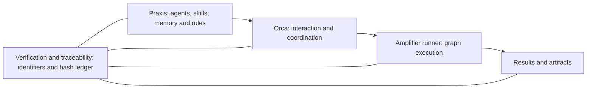

# Praxis 4.5

Praxis is a collection of agents, with the skills, memory and rules that let them work together. [Orca](https://github.com/stablyai/orca) provides the interaction and coordination host. [Amplifier](https://github.com/microsoft/amplifier) supplies the graph execution engine. Praxis 4.5 connects them through runner-backed execution and a verification layer with a hash ledger, so work can be traced from its sources and code to its runs and outputs.

This public edition contains the generic runner and agent-integration source, seven technical/source methods, and installation tooling. Personal workflows and their related skills, templates, examples and records are excluded as whole categories.



Praxis adapters connect agent contracts to the host and engine. The hash ledger records identity and integrity; contract checks and substantive review establish different things. A matching hash does not make a claim correct. Individual skills can also run without Amplifier when their task needs no graph execution.

## Run the 4.5 engine

The public runner prepares the pinned [Amplifier DOT runner engine](https://github.com/microsoft/amplifier-bundle-dot-runner) and exercises graph execution with synthetic workers. On macOS arm64 with Python 3.14:

```sh
python3 scripts/prepare-engine.py --download --destination "$PWD/.praxis-engine"
python3 scripts/praxis-runner.py rehearse --engine-root "$PWD/.praxis-engine" --output "$PWD/.praxis-rehearsal"
```

Run these from a clone of this repository. The [runner guide](services/praxis45/PUBLIC-RUNTIME.md) explains dependency verification, offline setup, supported platforms and the additional configuration for native agents. The rehearsal uses the real graph engine with synthetic operations; it does not launch agents or activate a service.

## General adaptive tasks

Configured rooms can use `/adaptive <objective>` for writing, editable slides,
code and tests, website builds, and explicitly requested publication. General
`native_task` nodes bind actual outputs, repeatable checks and workspace/tool
scope to the original request. The runner captures output bytes, verifies them,
and can reconcile a settled failed check without relaunching or republishing.
Read the [task guide](services/praxis45/ADAPTIVE-TASKS.md) for authority, source
snapshots, publication readback, continuation and the fictional example.
Native use still requires your own host, tools, accounts and registries; this
public update does not include personal workflows or live-run records.

## Use an individual skill

Browse the [skill catalog](docs/user-guide.md), configure the tools needed by the selected skill, and follow the [installation guide](docs/deploying.md). Claude Code and Codex consume the same `SKILL.md` procedures. Runtime-specific entry points do not change a skill's evidence or authorization requirements.

```sh
git clone https://github.com/yxy23/praxis.git
cd praxis
cp templates/user-config-template.sh ~/.praxis-config.sh
# Edit the copied configuration for your own workspace.
export PRAXIS_CONFIG_FILE="$HOME/.praxis-config.sh"
bash scripts/install-skill.sh convert
```

Then ask the active assistant to use `convert` on a document. The [installation guide](docs/deploying.md) also shows a disposable destination for trying the installer before changing your normal skill folders.

The methods can be used individually. Depending on the method, supply a document converter, reference manager, Markdown corpus, PDF tooling or semantic index. Their setup sections name those dependencies.

## Runtime source

The 4.5 source separates the Praxis agent collection, Orca coordination, Amplifier execution, and verification/traceability. VS Code can provide another interaction surface for an assistant; this does not imply it supplies Orca's native orchestration features. The shipped adapters must be matched to the host and engine capabilities actually available.

The source includes named-role routing, room coordination, worker dispatch, evidence records, constrained graph execution, and Deep Research/Fact Check components. Running an institutional deployment requires your own registries, policies, host capabilities and external engine dependencies.

Read [architecture](docs/architecture.md), [verification and traceability](docs/verification-traceability.md), [features and limits](docs/features-and-limits.md), and [configuration](docs/configuration.md) before using the runtime. Source publication, local tests, installation and a successful live workflow are separate claims.

## Versions and migration

The [release history](docs/release-history.md) explains the 1.x, 2.x, 3.x, 4.x and 4.5 generations. The [migration guide](docs/migration.md) explains the narrower public catalog. The same category exclusions apply to historical material; a version label does not exempt an artifact from review.

## Ingolstadt experiment

The [Ingolstadt archive](experiments/ingolstadt/README.md) preserves all 1,532,391 journal events, scientific code, results and supporting records within a disclosed publication boundary. Local path fields are projected to portable locators; original hash commitments and a separate public chain make that change explicit. Large evidence files are distributed as checked release assets. Download the [four evidence assets](https://github.com/yxy23/praxis/releases/tag/public/v4.5.0); the archive index gives checksums and verification commands. The [publication receipt](experiments/ingolstadt/PUBLICATION.json) records successful anonymous downloads and matching SHA-256 hashes.

The [ICIS supplementary materials](papers/icis-2026/README.md) retain the exact submitted PDF, including author attribution and contact information.

## Publishing model

The public repository is a deliberate projection of a private canonical source. Its [publishing policy](docs/publishing-policy.md) defines the boundary. Personal knowledge, account values, correspondence and credentials are excluded. Scientific evidence is published only as an explicitly reviewed archive with source identity, public hashes and disclosed redactions; runtime records are not included automatically.

Licensed under the [MIT License](LICENSE). Retain separate notices for any included upstream material.
