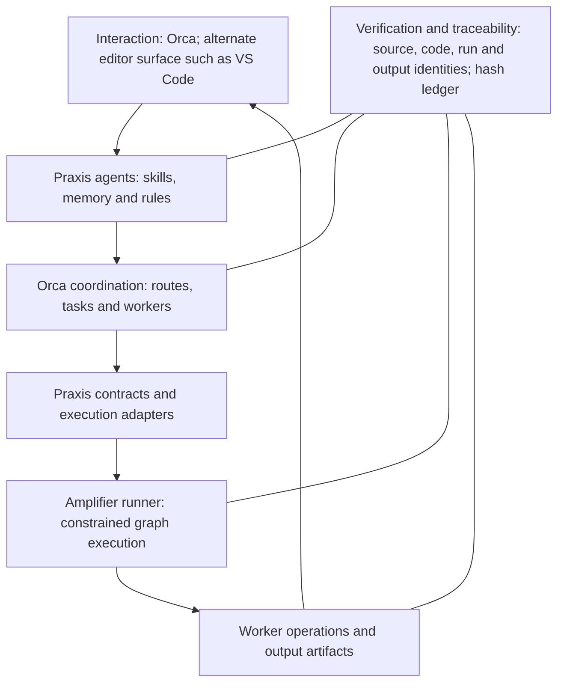

# Architecture

Praxis is the collection of agents and their skills, memory and rules. Orca supplies the interaction and coordination host. Amplifier supplies the graph execution engine. Praxis adapters connect those layers, while verification and traceability preserve the evidence chain through identifiers and a hash ledger.

The native adapter code uses Orca Run, Task and Dispatch capabilities and the pinned Amplifier pipeline engine. VS Code is a possible interaction environment for an assistant, not a claim that an equivalent native coordination adapter ships here. A standalone skill need not use the graph runner.

## Procedures and user state

`skills/<name>/SKILL.md` is the procedure. Auxiliary scripts and templates travel with it. Claude and Codex installations use the same rendered procedure. A slash command is an entry point, not a second workflow definition.

Keep deployment-specific state, source data and credentials outside the public checkout. A Markdown corpus is one supported arrangement; users can map the documented paths to an equivalent record system. Installation must preserve independently authored work.

## Dispatch and rooms

The Switchboard resolves a requested role through configured role and model registries. The dispatcher gives work a bounded specification, records host identities, collects original worker results and checks the requested outputs. Room services maintain request context and route follow-through.

Configured role names do not establish a worker's identity. Native host workers and institutional roles are distinct; a deployment must attest the intended route and actual launch. Lost contact or an unresolved original worker requires reconciliation before a replacement is launched.

## Amplifier runner integration in 4.5

Amplifier traverses the admitted graph. Praxis adapters map supported graph nodes onto native worker operations and apply the agent contracts; Orca owns the corresponding execution identities and worker lifecycle. Together these carry work through launch, collection, reconciliation and output checks. Planning alone does not perform these steps.

Evidence projection records what the host reports and preserves occurrence identity. Source-access helpers retain source identity and acquisition evidence. Coverage and output contracts expose unsupported or unchecked claims. Recovery reconciles original work before a retry so a lost response is not mistaken for an unstarted task.

The adaptive layer plans and supervises supported work under explicit capability contracts. A successful plan is not execution. Unsupported effects remain unsupported until a configured implementation supplies them. The published source includes integration code; it does not supply the author's private role registry, room history or approval records.

General adaptive execution is marked `production_admitted=False` in the published implementation. It uses ready layers, source-bound receipts and serialized allowlisted effects; it does not establish broad production admission or safe automatic upstream resume/retry. Keep this boundary distinct from the separately configured research/fact-check path.

## Evidence boundaries

The verification/traceability layer connects source hashes, pinned code identity, run/task/dispatch identifiers, receipts and output hashes. The ledger lets an operator ask which input and code produced a particular artifact and whether those bytes changed. Identity and integrity are separate from truth, adequate coverage, authorized effects and a useful result. Contract checks and substantive review remain necessary.

The [traceability guide](verification-traceability.md) maps these claims to the actual room trace, source-operation log, native provenance records and adaptive event outbox. Some paths use hash chains; others use individually hashed records. Optional tracing is not universal coverage.

Keep these states distinct: planned, launched, settled, contract accepted, artifact verified, delivered and accepted by the user. A process exit code, graph result or scheduler success does not establish every later state. Missing sources, partial reading, stale records and unverified delivery must remain visible.
